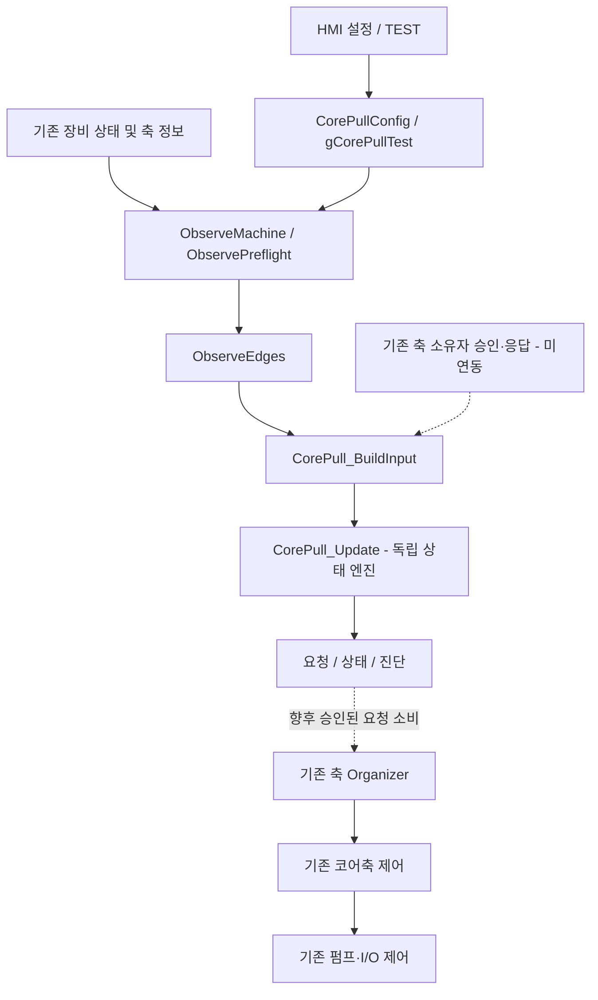

# 01. 개발 배경과 독립 설계

## 1. 문제 정의

기존 특수 코어풀은 형폐 완료 후 요청을 보류하고, 노즐터치 완료 및 실제 사출 시작을 기준으로 코어 전진 동작을 병렬 수행하는 기능이다. 신형 프로젝트에서는 코어 축 제어, 시퀀서, 펌프 배분, I/O 매핑의 역할이 이미 분리되어 있다. 구형 코드의 출력 주소나 제어 조건을 그대로 복사하면 주소 불일치, 중복 축 요청, 공용 펌프 제어 충돌이 발생할 수 있다.

기존 공용 제어기의 속도·압력·시간 기반 운동 제어와 안전 인터록은 그대로 재사용하는 것을 설계 목표로 잡았다. 특수 기능의 조건과 상태 관리만 분리하고, 공용 코드에 특수 분기를 누적시키지 않는다.

## 2. 시스템 경계

실선 중 독립 모듈의 범위는 설정·관측·진단·상태 제어까지다. 점선은 향후 연결 계약이며 실제 구동 경로가 구현됐다는 뜻이 아니다.

| 경계 | 구현 및 책임 |
|---|---|
| 순수 상태 엔진 | C90, PLC 헤더 없이 빌드 가능. Context / Input / Output만 사용 |
| 장비 어댑터 | 같은 C 파일의 AS 전용 영역. 기존 장비 변수 관측, 모드 변환, 진단 |
| 설정 | CorePullConfig만 RETAIN. 공용 FIX/REC 구조체를 확장하지 않음 |
| 실행 | 별도 프로그램으로 Logical View에 두고 Software Configuration(.sw)에서 20 ms Task로 등록 |
| HMI | 기존 페이지에 전용 설정과 TEST를 연결. 실행 여부와 별개의 표시·입력 경계 |
| 기존 공용 제어 | 현재 읽기만 함. 실제 제어권·출력은 기존 운전 프로그램에 남겨둠 |

## 3. 왜 독립 Task인가

- 기능 단위 응집: 상태, 설정, 입력 관측, 오류 사유가 두 파일 안에서 추적된다.
- 낮은 결합도: 공용 제어기 또는 금형 데이터 구조를 직접 변경하지 않아 다른 기종의 회귀 영향 범위를 줄인다.
- 이식·제거 용이성: 새 기종의 기존 상태 변수와 형식을 어댑터에서 맞추고, Task 및 HMI 바인딩을 추가하거나 제거한다.
- 테스트 가능성: 장비 없이도 순수 엔진에 가상 입력·응답을 주어 정상·실패 경로를 검증한다.
- 단계적 적용: 관측만 하는 버전을 먼저 실행하여 타이밍과 충돌을 확인한다. 실행 승인 없이 장비 출력으로 이어지지 않는다.

`.sw` 등록 외에도 HMI의 변수·가상키 연결 및 기존 전역변수/헤더 의존성이 존재한다. 따라서 **공용 C/H 수정 없이 분리한 독립 Task**라는 표현은 정확하지만, 모든 프로젝트 의존성이 없는 독립 바이너리라는 표현은 부정확하다. 실구동 버전은 축 소유 인터페이스에 추가로 연결돼야 한다.

## 4. 공용 제어와 특수 기능의 분리

수동 시퀀서와 자동 시퀀서는 각자 축 시작/정지 및 유량·압력 파라미터를 관리한다. 빈 축을 관측한 것만으로 제어권을 획득했다고 볼 수 없다. 현재 두 파일은 기존 시퀀서나 공용 축 제어기를 수정하지 않으며, 직접 밸브·펌프·축 명령을 쓰지 않는다.

공용 코어 제어기에는 시간 기반 전진과 밸브 지연, 시간 만료 후 정지 경로가 이미 존재한다. 향후 검증된 기존 요청 경로를 사용하고, 특수 모듈은 공정 조건 및 트랜잭션의 수명만 관리하는 것이 목표다. 기존 안전 기능을 대체하거나 안전 등급이 있는 모듈로 해석하지 않는다.
